# SmartLiving — Smart Property Rental & Deposit Management

เว็บแอปบริหารสัญญาเช่าอสังหาริมทรัพย์และเงินประกันบน Ethereum Testnet โดยใช้ **Solidity + Remix IDE + React/Vite + ethers.js v6 + MetaMask + Infura** 

## สมาชิกกลุ่ม
66044011 นายทัตซึโนริ คาโต้

66066266 นางสาวเบญจวรรณ พูลทรัพย์

66050217 นางสาวกัลยรัตน์ ถิ่นหาญวงศ์

66023796 นางสาวณัฐชยา ตั้งมั่น

## ฟังก์ชันที่รองรับ

1. **Register Property** — เจ้าของห้องลงทะเบียนชื่อ ที่ตั้ง ค่าเช่าต่องวด และเงินประกัน (ETH)
2. **Create Rental Agreement** — เจ้าของห้องสร้างสัญญา ระบุผู้เช่า วันเริ่ม/สิ้นสุด และ Hash ของเงื่อนไข; เจ้าของลงนามเมื่อสร้าง
3. **Confirm Agreement** — ผู้เช่ากดลงนามด้วย MetaMask (Wallet address)
4. **Deposit Security** — ผู้เช่าฝาก ETH จำนวนตรงกับเงินประกันเข้า Smart Contract โดยตรง
5. **Record Rental Payment** — ผู้เช่าจ่าย ETH ให้เจ้าของโดยตรงผ่าน Contract; บันทึกยอดและเวลาแต่ละงวดบนเชน
6. **Refund Deposit** — หลังวันสิ้นสุดสัญญา เปิดขั้นตอนตรวจห้อง เจ้าของอนุมัติ และคืนเงินประกันผ่าน Contract
7. **Rental Dispute** — คู่สัญญาเปิดข้อพิพาทพร้อมเหตุผล ผู้ตัดสิน (arbiter) ที่กำหนดตั้งแต่ Deploy พิจารณายอดหักและเหตุผล แล้วจึงชำระบัญชี

### กฎธุรกิจ

- เงินประกันถูกล็อกใน Contract ไม่โอนให้เจ้าของทันที
- การหักเงินประกันแบบตกลงกัน ต้องมี **ผู้เช่ายอมรับยอดหักพร้อมเหตุผล** และ **เจ้าของอนุมัติการตรวจห้อง**
- เมื่อมีข้อพิพาท ผู้ตัดสินที่ได้รับสิทธิ์เท่านั้นเป็นผู้กำหนดยอดหัก
- ไม่สามารถหักเกินเงินประกันคงเหลือ; ยอดคืน + ยอดหัก = เงินประกันที่ล็อก
- เมื่อปิดสัญญาแล้ว ไม่สามารถถอนเงินประกันซ้ำ
- หากตรวจห้องผ่านและไม่มีการยอมรับยอดหัก ระบบคืนเต็มจำนวน
- ค่าเช่าต่องวดเป็นจำนวนคงที่; ตัวอย่างนี้ไม่ได้บังคับความถี่งวดตามปฏิทินหรือจัดการค่าเช่าค้างชำระ

## โครงสร้าง

```text
smartliving-rental/
├── contracts/SmartRental.sol   # Smart Contract
├── src/App.jsx                 # UI และการทำธุรกรรม
├── src/abi.js                  # ABI ที่ frontend ใช้งาน
├── src/style.css               # สีฟ้า-ขาว / responsive
├── src/main.jsx
├── .env.example
├── index.html
├── vite.config.js
└── package.json
```

## 3. วิธีรัน

```bash
npm install
npm run dev
```

## 4. ขั้นตอนทดสอบแบบครบวงจร

ใช้ MetaMask 4 Wallet: **Owner**, **Tenant**, **Arbiter** และ **Observer** (ไม่ต้องเชื่อม Wallet ก็อ่านข้อมูลสาธารณะได้)

1. **Owner** เชื่อมต่อ MetaMask ในหน้าอสังหาริมทรัพย์ เลือกลงทะเบียนห้อง A101 ค่าเช่า `0.001 ETH` เงินประกัน `0.002 ETH`
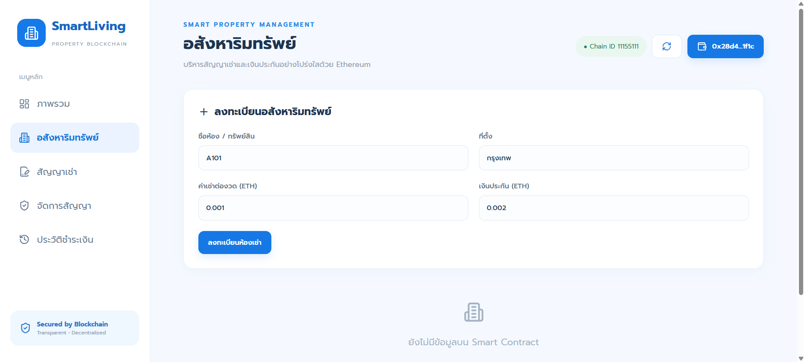

2. **Owner** ในหน้าสัญญาเช่า เลือกห้อง และใส่ Wallet Tenant วันเริ่มต้นและวันสิ้นสุดในอนาคต พร้อมเงื่อนไข และกดสร้างสัญญา
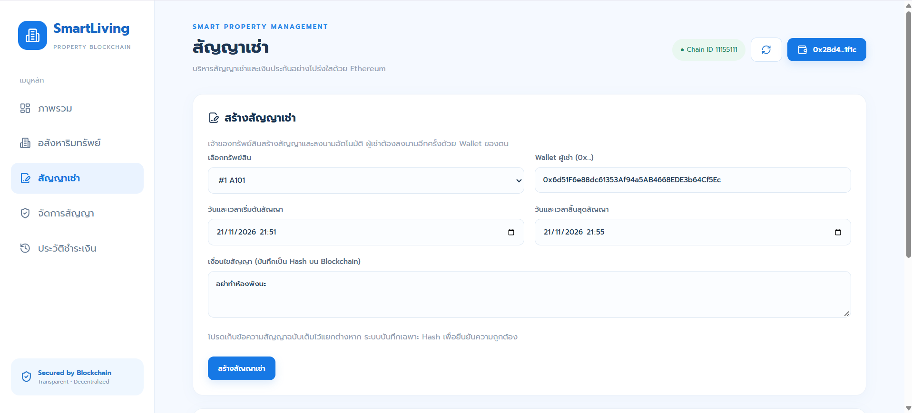

3. **Tenant** สลับไป Wallet Tenant ในหน้าจัดการสัญญา เลือกสัญญา เลือก **ยืนยันสัญญาด้วย Wallet**
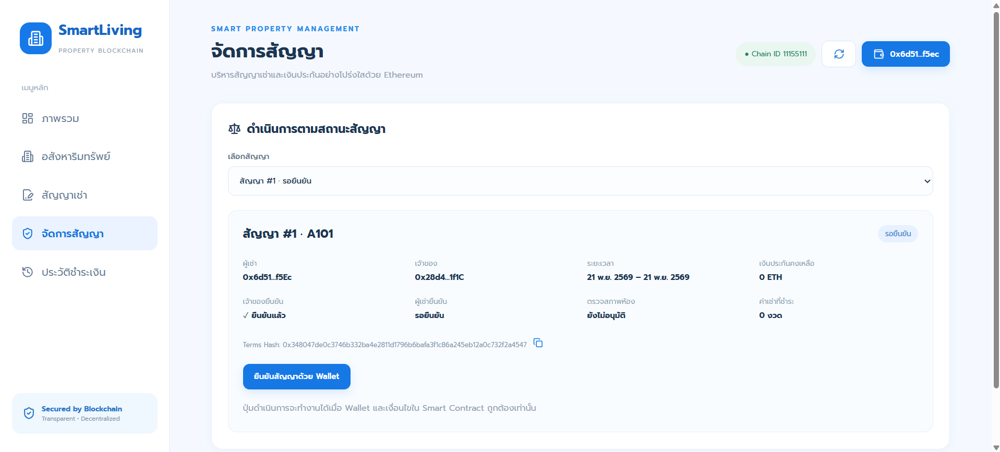

4. **Tenant** → **ฝากเงินประกัน 0.002 ETH** (แยกค่า Gas)
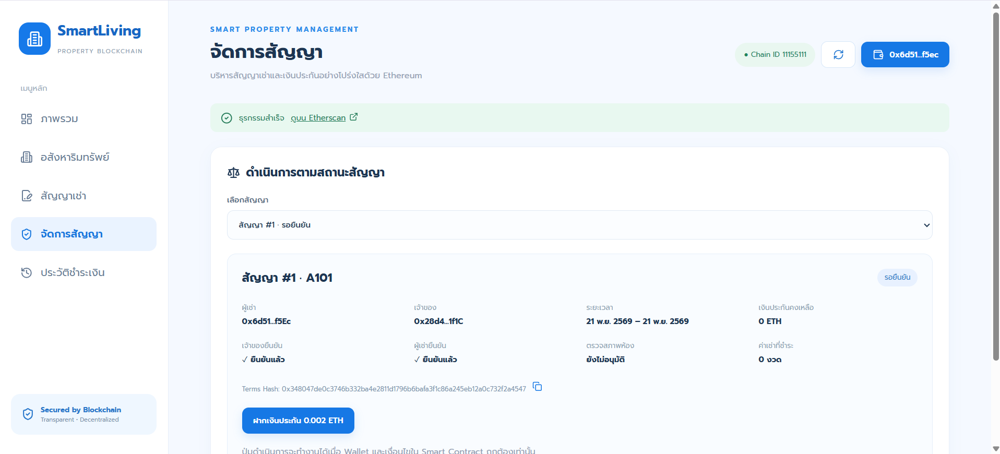

5. **Tenant** → **ชำระค่าเช่า 0.001 ETH** แล้วตรวจสอบหน้า **ประวัติชำระเงิน** และยอดเงินที่ Owner ได้รับ
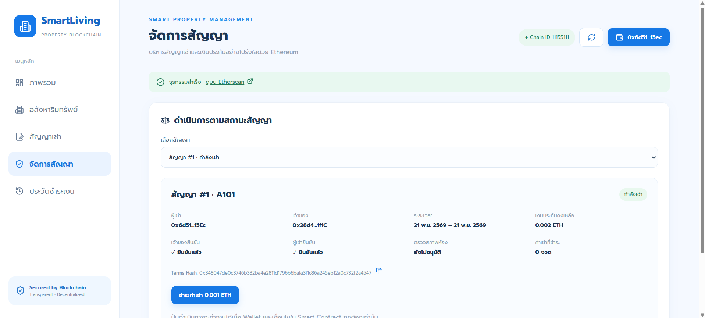
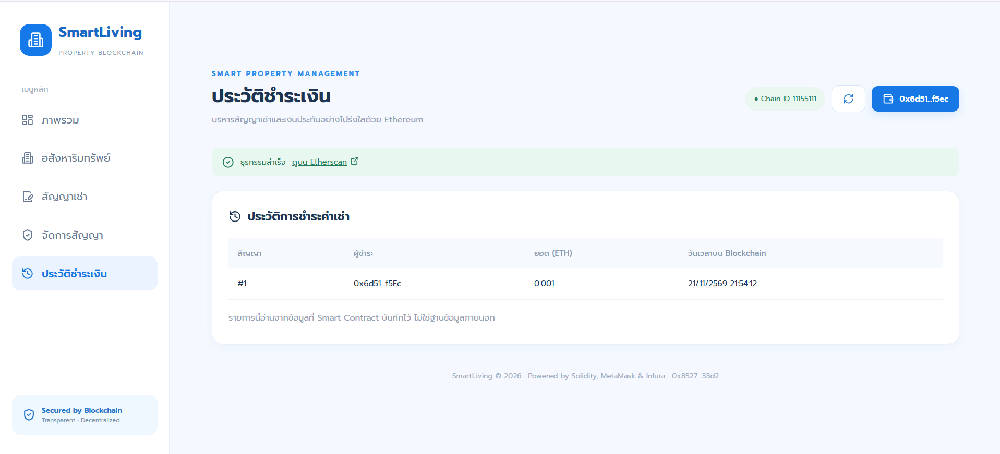

6. เมื่อเวลาบน Blockchain ผ่านวันสิ้นสุดสัญญาแล้ว Owner หรือ Tenant กด **เริ่มตรวจสภาพห้อง**
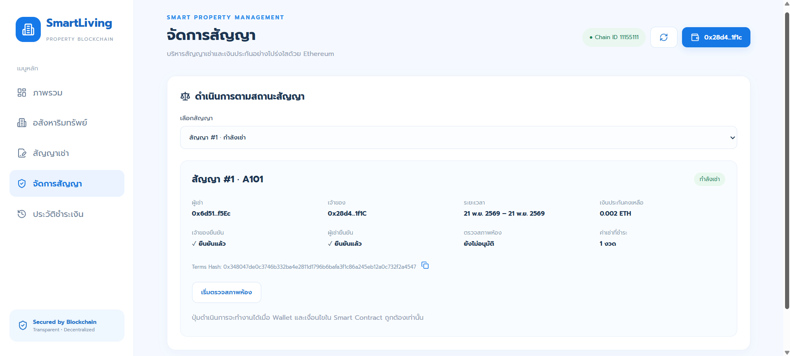

7. **กรณีไม่มีความเสียหาย:** Owner กด **ยืนยันตรวจสภาพห้องผ่าน** แล้วจึงกด **คืน / จัดสรรเงินประกัน** Tenant ได้รับ `0.002 ETH`
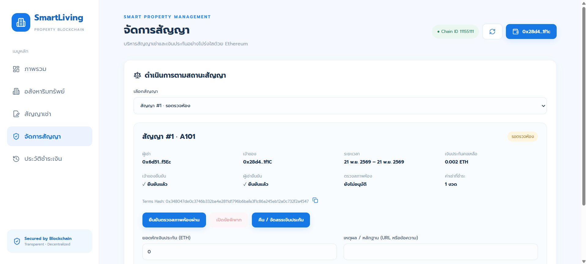
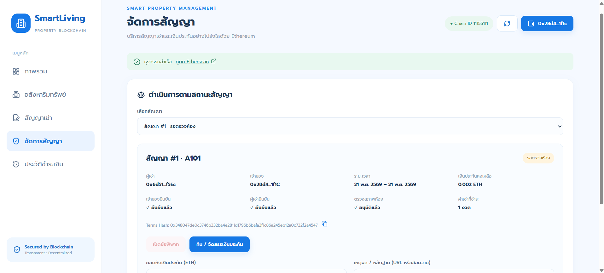
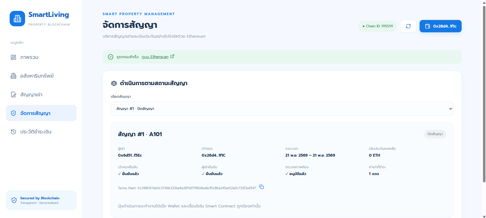

8. **กรณีหักเงินแบบตกลง:** Owner อนุมัติการตรวจ → Tenant กรอกยอดหัก `0.0005 ETH` พร้อมเหตุผล → กด **ผู้เช่ายอมรับยอดหัก** → กดคืนเงิน → Tenant ได้ `0.0015 ETH`, Owner ได้ `0.0005 ETH`
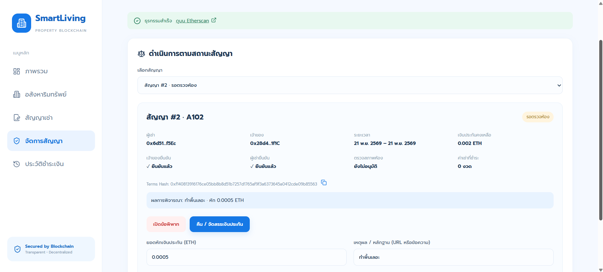

9. **กรณีข้อพิพาท:** ก่อนปิดสัญญา Owner หรือ Tenant กรอกเหตุผล → กด **เปิดข้อพิพาท** → สลับ Wallet Arbiter → กรอกยอดหักและเหตุผล → กด **ผู้ตัดสินอนุมัติผลข้อพิพาท** → กด **คืน / จัดสรรเงินประกัน**

> สำหรับทดสอบกรณีสิ้นสุดสัญญา ให้กำหนดวันสิ้นสุดใกล้ ๆ ในอนาคต (เช่น วันถัดไป) แล้วรอจริง หรือทดสอบด้วย Remix VM และปรับเวลาบล็อกในสภาพแวดล้อมทดสอบเฉพาะทาง ไม่สามารถเร่งเวลาของ Sepolia ได้เอง
